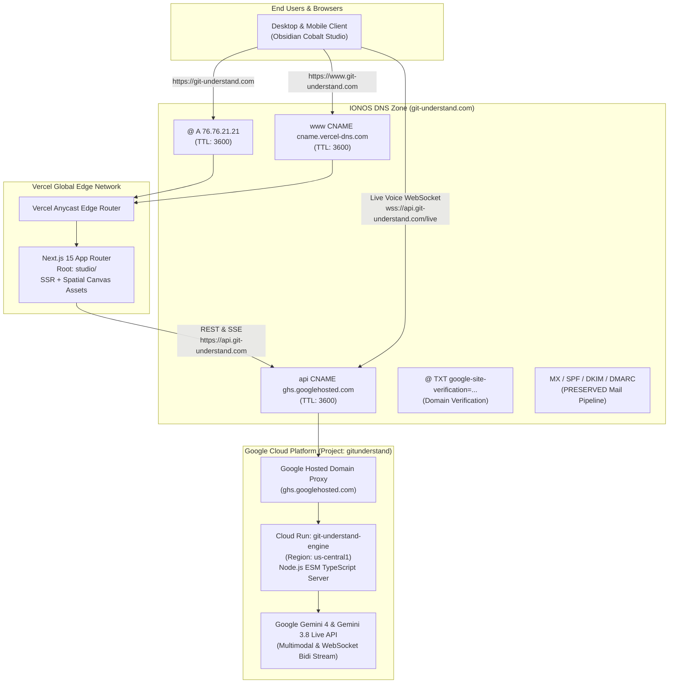

# GitUnderstand Deployment Guide

> **Production Topology**: `git-understand.com`  
> **Frontend Studio**: Vercel (Next.js 15 + React 19)  
> **Backend Engine**: Google Cloud Run (`git-understand-engine` in project `gitunderstand`)  
> **DNS Provider**: IONOS Cloud / 1&1 IONOS Domain Center  

---

## 1. System Architecture & Routing Topology

GitUnderstand is architected as a decoupled, visual-first system. The Next.js Studio frontend is globally distributed at the edge via Vercel, while the computational engine runs as a containerized microservice on Google Cloud Run with persistent WebSocket streaming for Gemini 3.8 Live API voice sessions.



---

## 2. IONOS DNS Zone Configuration

Log in to the [IONOS Control Center](https://my.ionos.com) -> **Domains & SSL** -> **git-understand.com** -> **DNS** tab.

### 2.1 Complete DNS Records Table

| Host / Subdomain | Record Type | Value / Destination | TTL | Purpose / Service |
| :--- | :--- | :--- | :--- | :--- |
| `@` (root) | **A** | `76.76.21.21` | 1 hour (3600) | Vercel Apex IP routing |
| `www` | **CNAME** | `cname.vercel-dns.com.` | 1 hour (3600) | Vercel Canonical Subdomain routing |
| `api` | **CNAME** | `ghs.googlehosted.com.` | 1 hour (3600) | Google Cloud Run Custom Domain Mapping |
| `@` | **TXT** | `google-site-verification=...` | 1 hour (3600) | Cloud Run Custom Domain Ownership Verification |
| `@` | **MX** | *(Retain IONOS Defaults)* | Default | **KEEP INTACT** (Mail delivery) |
| `@` | **TXT** | `v=spf1 include:_spf-eu.ionos.com ~all` | Default | **KEEP INTACT** (SPF email authenticity) |
| `*._domainkey` | **CNAME / TXT** | *(Retain IONOS Defaults)* | Default | **KEEP INTACT** (DKIM signing) |
| `_dmarc` | **TXT** | `v=DMARC1; p=none; ...` | Default | **KEEP INTACT** (DMARC policy) |

> [!CAUTION]
> **CRITICAL: Preserving IONOS Mail Records**  
> Under no circumstances delete or overwrite existing **MX**, **SPF**, **DKIM**, or **DMARC** records when modifying root (`@`) records. IONOS email services will cease functioning if MX or SPF records are replaced by generic single-record overrides. Only update the `@ A` record from IONOS Parked IP to `76.76.21.21` and add the specific Google verification TXT record.

---

## 3. Vercel Studio Deployment

The Next.js 15 studio frontend lives in the `studio/` workspace directory.

### 3.1 Project Settings

1. In the Vercel Dashboard, select **Add New Project** -> Import the `GitUnderstand` repository.
2. Configure project settings:
   - **Framework Preset**: `Next.js`
   - **Root Directory**: `studio` *(Click "Edit" and enter `studio`)*
   - **Build Command**: `next build`
   - **Output Directory**: `.next`
   - **Install Command**: `npm install`

### 3.2 Environment Variables

Set the following environment variables in Vercel (**Settings** -> **Environment Variables**):

| Variable Name | Environment | Value | Description |
| :--- | :--- | :--- | :--- |
| `NEXT_PUBLIC_BACKEND_URL` | Production, Preview, Dev | `https://api.git-understand.com` | Base URL of Cloud Run backend engine |
| `NEXT_PUBLIC_SITE_URL` | Production | `https://git-understand.com` | Canonical site origin for metadata/OpenGraph |
| `NODE_ENV` | Production | `production` | Production runtime flag |

### 3.3 Domain Mapping on Vercel

1. Navigate to **Project Settings** -> **Domains**.
2. Add `git-understand.com`.
   - Vercel will prompt you to add `www.git-understand.com` as well.
   - Recommended configuration:
     - Production domain: `git-understand.com`
     - Redirect: `www.git-understand.com` redirects to `git-understand.com` (Status 308 Permanent).
3. Once the IONOS `@ A 76.76.21.21` and `www CNAME cname.vercel-dns.com` records propagate, Vercel will automatically provision Let's Encrypt TLS certificates.

### 3.4 CLI Deployment Commands

```bash
# Link project to Vercel (first time setup)
vercel link

# Deploy Preview build
vercel

# Deploy Production build
vercel --prod
```

---

## 4. Google Cloud Run Backend Engine (`git-understand-engine`)

The backend engine processes repository parsing, visual lens AST derivation, and Gemini 4 / Live API bidirectional streaming.

### 4.1 Prerequisites & Project Configuration

Ensure the Google Cloud SDK (`gcloud`) is authenticated and configured to the target project:

```bash
# Authenticate and set project
gcloud auth login
gcloud config set project gitunderstand

# Enable required Google Cloud APIs
gcloud services enable \
  run.googleapis.com \
  containerregistry.googleapis.com \
  cloudbuild.googleapis.com \
  secretmanager.googleapis.com
```

### 4.2 Cloud Run Deployment Command

Run the deployment from the repository root:

```bash
gcloud run deploy git-understand-engine \
  --project=gitunderstand \
  --region=us-central1 \
  --source=. \
  --platform=managed \
  --allow-unauthenticated \
  --port=8080 \
  --cpu=2 \
  --memory=2Gi \
  --min-instances=1 \
  --max-instances=10 \
  --concurrency=80 \
  --session-affinity \
  --set-env-vars="PORT=8080,NODE_ENV=production,CORS_ORIGIN=https://git-understand.com,https://www.git-understand.com,http://localhost:3000" \
  --set-secrets="GEMINI_API_KEY=GEMINI_API_KEY:latest"
```

> [!NOTE]
> **Why `--session-affinity` and `--min-instances=1`?**
> - **Session Affinity**: Guarantees WebSocket connections for Gemini 3.8 Live voice streams persist to the same Cloud Run instance throughout the active voice session.
> - **Min Instances**: Eliminates cold starts, ensuring sub-50ms TTFB for initial repository ingestion requests and immediate speech recognition.

### 4.3 Custom Domain Mapping (`api.git-understand.com`)

Map `api.git-understand.com` to Cloud Run:

```bash
# Map custom domain to Cloud Run service
gcloud beta run domain-mappings create \
  --service=git-understand-engine \
  --domain=api.git-understand.com \
  --project=gitunderstand \
  --region=us-central1
```

If prompted for domain ownership verification:
1. Copy the provided Google Site Verification TXT string (`google-site-verification=...`).
2. Add the TXT record to IONOS DNS for host `@`.
3. In IONOS DNS, add the CNAME record:
   - **Host**: `api`
   - **Type**: `CNAME`
   - **Points to**: `ghs.googlehosted.com.`
4. Google will automatically issue and renew a Google-managed SSL/TLS certificate for `api.git-understand.com`.

---

## 5. Verification & Health Checks

Once DNS propagation completes (typically 5–30 minutes), execute these validation commands:

### 5.1 DNS Resolution

```bash
# Verify Vercel Apex resolution
dig +short A git-understand.com
# Expected: 76.76.21.21

# Verify Vercel WWW CNAME resolution
dig +short CNAME www.git-understand.com
# Expected: cname.vercel-dns.com.

# Verify Cloud Run API CNAME resolution
dig +short CNAME api.git-understand.com
# Expected: ghs.googlehosted.com.

# Verify Mail delivery MX records are untouched
dig +short MX git-understand.com
# Expected: IONOS MX servers (e.g. mx00.ionos.com / mx01.ionos.com)
```

### 5.2 HTTP & SSL Health Checks

```bash
# Verify Frontend HTTP 200 & Security Headers
curl -I https://git-understand.com

# Verify API Engine Health Endpoint
curl -i https://api.git-understand.com/health
# Expected: HTTP/2 200 OK {"status":"ok","version":"3.0.0"}

# Verify CORS Preflight from Studio Origin
curl -I -X OPTIONS https://api.git-understand.com/api/ingest \
  -H "Origin: https://git-understand.com" \
  -H "Access-Control-Request-Method: POST"
# Expected: Access-Control-Allow-Origin: https://git-understand.com
```

### 5.3 WebSocket Live Voice Verification

```bash
# Verify bidirectional WebSocket upgrade on Cloud Run
wscat -c wss://api.git-understand.com/live
# Expected: Connected to wss://api.git-understand.com/live
```

---

## 6. Troubleshooting Runbook

| Symptom | Probable Cause | Resolution |
| :--- | :--- | :--- |
| **SSL Certificate Pending on `api.git-understand.com`** | DNS CNAME `ghs.googlehosted.com.` not yet propagated or TXT record unverified. | Run `gcloud beta run domain-mappings describe --domain api.git-understand.com --region us-central1`. Ensure TXT verification record exists in IONOS. |
| **CORS Blocked in Browser Console** | `CORS_ORIGIN` environment variable missing `https://git-understand.com`. | Update Cloud Run env vars: `gcloud run services update git-understand-engine --update-env-vars CORS_ORIGIN=https://git-understand.com,https://www.git-understand.com --region us-central1`. |
| **Live Voice WebSocket disconnects with 1006** | Cloud Run HTTP/2 or WebSocket timeout reached, or session affinity disabled. | Ensure `--session-affinity` is enabled and `--timeout=3600` is set on the Cloud Run service. |
| **Studio fails to build on Vercel** | Root directory not set to `studio`. | In Vercel Project Settings -> General, set **Root Directory** to `studio`. |
| **IONOS Mail Bouncing** | MX records were inadvertently removed during apex A record edit. | Restore IONOS MX records immediately: `mx00.ionos.com` (priority 10) and `mx01.ionos.com` (priority 10). |
