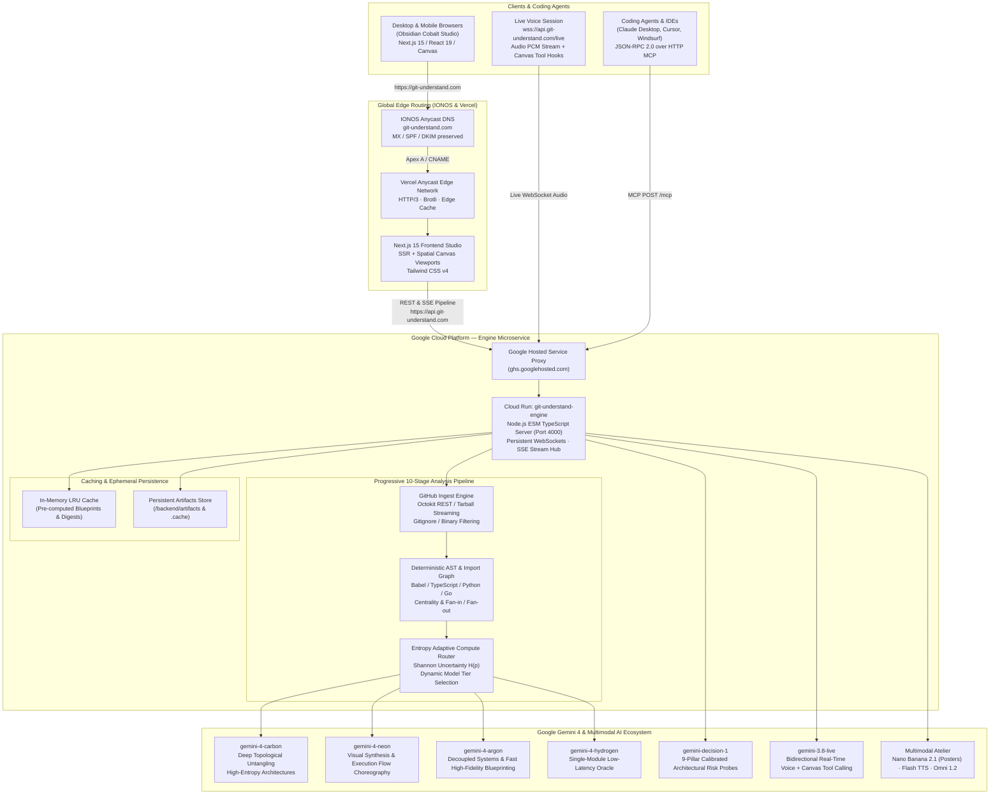
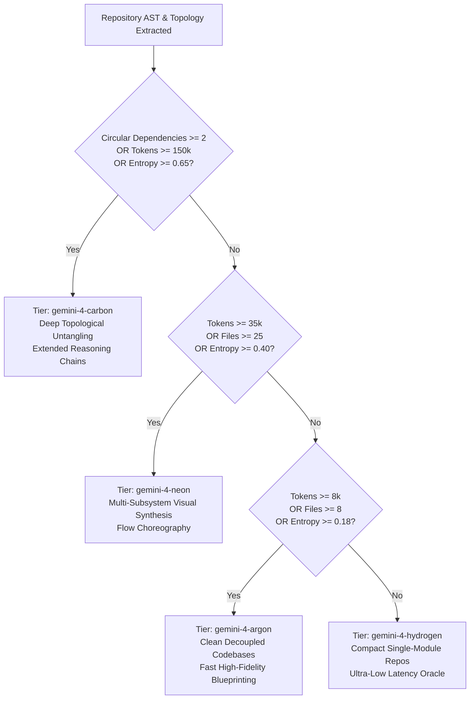
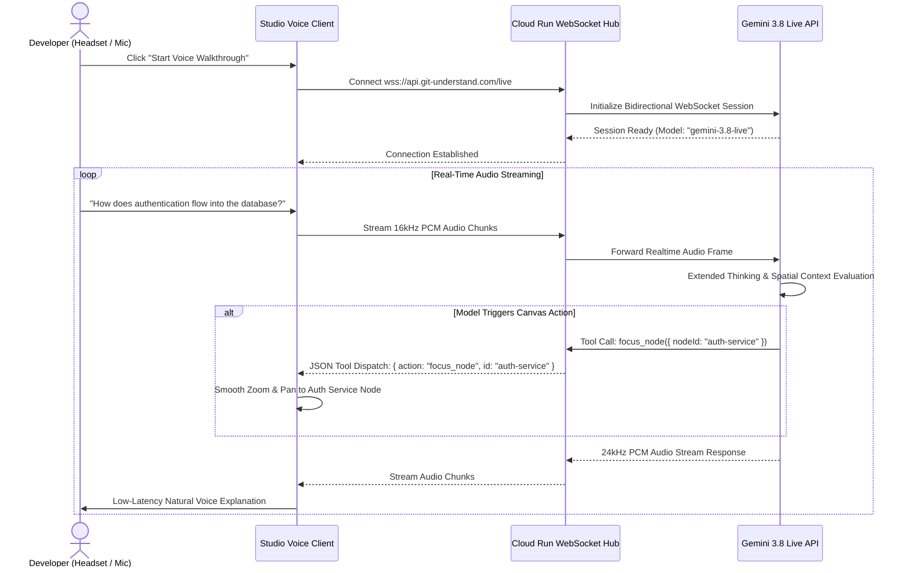
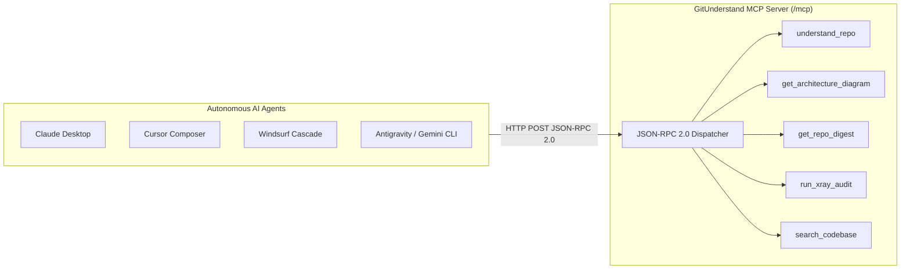

# GitUnderstand — Technical Architecture & System Design

> **Production Domain**: `git-understand.com`  
> **API & Compute Endpoint**: `https://api.git-understand.com`  
> **Repository**: [github.com/shantanugoel/GitUnderstand](https://github.com/shantanugoel/GitUnderstand)  
> **Design Philosophy**: *"No one reads code anymore — MORE VISUALS."*  
> **Palette System**: Obsidian Cobalt (`#07090E`, `#0D1117`, `#1E293B`) + Archival Paper accents

---

## 1. System Topology & Architectural Overview

GitUnderstand is architected as an asymmetrical, decoupled system designed to ingest any public or private GitHub repository, reconstruct its architectural topology deterministically via AST analysis, and synthesize interactive visual canvases, 3D strata layers, choreographed execution flows, calibrated Decision-1 X-Ray health matrices, and real-time multimodal audio/video/voice tours via Google Gemini 4.



---

## 2. Progressive 10-Stage SSE Pipeline

Repository analysis does not block behind a massive monolithic API response. Instead, GitUnderstand uses a real-time **Server-Sent Events (SSE)** telemetry stream (`/api/analyze/stream?repoUrl=...`) that updates the studio UI progressively from 0% to 100%.

The user observes the architecture materialize before their eyes: the file treemap renders first, followed by structural clusters, execution flows, calibrated risk heatmaps, and finally high-fidelity generative visual posters and audio walkthroughs.

```mermaid
sequenceDiagram
    autonumber
    actor User as Developer / Agent
    participant Studio as Next.js 15 Studio
    participant Engine as Cloud Run Engine
    participant Ingest as AST & Ingest Worker
    participant Entropy as Entropy Router
    participant Gemini as Gemini 4 Model Tier

    User->>Studio: Input GitHub Repo URL
    Studio->>Engine: GET /api/analyze/stream?repoUrl=... (SSE)
    activate Engine
    Engine-->>Studio: event: progress { stage: "queued", percent: 5 }

    rect rgb(13, 17, 23)
        Note over Engine,Ingest: Stage 1-4: Deterministic AST & Graph Analysis (0-40%)
        Engine->>Ingest: Fetch Tree & Ingest Source Files
        Engine-->>Studio: event: progress { stage: "fetching", percent: 15 }
        Ingest->>Ingest: Parse AST Imports, Exports & Symbols
        Engine-->>Studio: event: progress { stage: "ast_graph", percent: 28 }
        Ingest->>Ingest: Build Token-Budgeted Hierarchical Treemap
        Engine-->>Studio: event: progress { stage: "treemap", percent: 40 }
    end

    rect rgb(23, 37, 84)
        Note over Engine,Gemini: Stage 5-8: AI Synthesis & Model Routing (40-85%)
        Engine->>Entropy: Calculate Graph Complexity & Shannon Entropy H(p)
        Entropy-->>Engine: Select Model Tier (Carbon / Neon / Argon / Hydrogen)
        Engine->>Gemini: Synthesize Subsystems, Strata Layers & Visual Atlas
        Engine-->>Studio: event: progress { stage: "architect", percent: 55, model: "gemini-4-neon" }
        Engine->>Gemini: Generate Interconnected Mermaid Diagram Specs
        Engine-->>Studio: event: progress { stage: "diagrams", percent: 68 }
        Engine->>Gemini: Trace Critical Execution Flows with Source Line Pointers
        Engine-->>Studio: event: progress { stage: "flows", percent: 78 }
        Engine->>Gemini: Run Decision-1 9-Pillar Calibrated Risk Matrix
        Engine-->>Studio: event: progress { stage: "xray", percent: 88 }
    end

    rect rgb(15, 23, 42)
        Note over Engine,Gemini: Stage 9-10: Multimodal Vector Indexing & Final Blueprint (88-100%)
        Engine->>Gemini: Generate Node Vector Embeddings (Gemini Embedding-2)
        Engine-->>Studio: event: progress { stage: "embeddings", percent: 94 }
        Engine-->>Studio: event: progress { stage: "ready", percent: 100, blueprintId: "..." }
        Engine-->>Studio: event: complete { blueprint: VisualAtlasBlueprint }
    end
    deactivate Engine
```



### Stage Breakdown & Invariants

| Stage | Identifier | Progress | Computational Nature | Primary Deliverables |
| :--- | :--- | :--- | :--- | :--- |
| **1. Queued** | `queued` | 0% – 5% | Deterministic | Canonical URL normalization, rate limit verification, LRU cache check. |
| **2. Fetching** | `fetching` | 5% – 20% | I/O Bound | GitHub REST API tree fetch or streaming `.tar.gz` archive ingest; gitignore & binary filtering. |
| **3. AST Graph** | `ast_graph` | 20% – 35% | CPU Bound | Polyglot AST symbol parsing (TypeScript, JavaScript, Python, Go, Rust); centrality scoring, fan-in/fan-out graph metrics. |
| **4. Treemap** | `treemap` | 35% – 45% | Deterministic | Hierarchical directory token treemap construction with file type categorization and byte-to-token projections. |
| **5. Architect** | `architect` | 45% – 60% | Gemini 4 LLM | Subsystem clustering, 3D strata height allocation, architectural headline, one-liner, and tech stack detection. |
| **6. Diagrams** | `diagrams` | 60% – 72% | Gemini 4 LLM | Self-healing Mermaid specs (architecture flowchart, sequence, class hierarchy, ER diagram) with node-to-file mappings. |
| **7. Flows** | `flows` | 72% – 82% | Gemini 4 LLM | End-to-end choreographed execution flows tracing API calls through subsystems to data persistence with line ranges. |
| **8. X-Ray** | `xray` | 82% – 90% | Gemini Decision-1 | 9-pillar calibrated architectural risk audit with binary probability probes and Shannon entropy uncertainty computation. |
| **9. Embeddings** | `embeddings` | 90% – 97% | Gemini Embedding-2 | 768-dimensional dense vector embeddings per subsystem and entrypoint node for multimodal semantic lasso search. |
| **10. Ready** | `ready` | 97% – 100% | Serialization | Atomic write to persistent disk store and in-memory LRU cache; emission of canonical `VisualAtlasBlueprint`. |

---

## 3. Entropy-Adaptive Model Routing Engine

A core innovation in GitUnderstand is the **Shannon Entropy Adaptive Router** (`backend/src/gemini/entropyRouter.ts`). Rather than sending all repositories to a single arbitrary model, GitUnderstand calculates the mathematical uncertainty and topological entanglement of the codebase to select the optimal Gemini 4 tier.

### Mathematical Formulation

For any calibrated binary probability probe $p \in [0, 1]$ generated during architectural inspection:

$$\mathcal{H}(p) = -p \log_2(p) - (1 - p) \log_2(1 - p)$$

- When $p \to 0$ or $p \to 1$: $\mathcal{H}(p) \to 0$ (The architectural invariant is deterministic; minimal reasoning compute required).
- When $p = 0.5$: $\mathcal{H}(p) = 1.0$ (Maximal architectural ambiguity and epistemic uncertainty; maximum reasoning depth required).

The combined **Effective Structural Entropy** is computed as:

$$\mathcal{S} = 0.45 \cdot \min\left(1, \frac{C_{\text{circular}}}{3}\right) + 0.35 \cdot \min\left(1, \frac{T_{\text{tokens}}}{120\,000}\right) + 0.20 \cdot \min\left(1, \frac{N_{\text{files}}}{60}\right)$$

### Routing Decision Matrix



---

## 4. The 7 Visual Lenses Architecture

Every repository is projected across 7 specialized visual lenses within the Studio. Raw source code is deliberately segregated to a secondary "Peek Source" tab in accordance with the visual-first doctrine:

```
┌─────────────────────────────────────────────────────────────────────────────┐
│ Obsidian Cobalt Studio Viewport (Next.js 15 + React 19)                     │
├─────────┬──────────┬──────────┬───────────┬─────────┬───────────┬───────────┤
│ 1.Atlas │ 2.Strata │ 3.Flows  │ 4.Treemap │ 5.X-Ray │ 6.Mermaid │ 7.Media   │
│ (Canvas)│ (3D Isom)│ (Anim)   │ (Tokens)  │(Entropy)│ (Diagram) │ (Atelier) │
└─────────┴──────────┴──────────┴───────────┴─────────┴───────────┴───────────┘
```

1. **Atlas Canvas (`AtlasGraphCanvas.tsx`)**: High-performance interactive 2D node-link spatial canvas powered by HTML5 Canvas and force-directed cluster physics. Renders subsystem boundaries, entrypoints, and hot-path communication edges.
2. **Strata 3D (`Strata3DView.tsx`)**: Three.js / WebGL isometric spatial stack. Elevates client, edge, orchestration, domain, infrastructure, data, and tooling into stacked 3D planes with glowing inter-plane dependency lasers.
3. **Flows (`FlowAnimatorView.tsx`)**: Choreographed step-by-step execution path tracer. Animates synthetic packet pulses through nodes while displaying actual source file line ranges and payload contracts.
4. **Token Treemap (`TokenTreemapView.tsx`)**: D3-style squarified hierarchical treemap showing exact token budget distribution across directories, color-coded by architectural layer.
5. **Decision-1 X-Ray (`XRayMatrixView.tsx`)**: Calibrated 9-pillar audit heatmap evaluating Modularity, Security, Resilience, Testability, API Clarity, Concurrency, Scalability, Hygiene, and Onboarding. Displays calibrated $P(\text{healthy})$, confidence intervals, and Shannon entropy.
6. **Mermaid Studio (`MermaidStudioView.tsx`)**: Live interactive SVG renderer with self-healing syntax validation, pan/zoom controls, and clickable nodes that navigate directly to source files.
7. **Media Lab (`MediaLabView.tsx`)**: Generative multimedia showcase containing architectural blueprint posters (`gemini-nano-banana-2.1`), dual-host audio podcast tours (`gemini-3.8-flash-tts`), and kinetic video reels (`gemini-omni-1.2-flash`).

### Circle-to-Explain Lasso Subsystem

The **Circle-to-Explain** overlay (`CircleToExplainOverlay.tsx`) allows developers to draw a freehand lasso around any cluster of nodes or edges on the Atlas canvas. The studio captures the bounding coordinates and spatial snapshot, identifies the enclosed AST nodes, and queries `circleExplainer.ts` via Gemini Multimodal. The model returns an executive architectural summary, data flow narrative, contract obligations, and potential risks for the selected subsystem.

---

## 5. Live Voice Tutor & WebSocket Infrastructure

GitUnderstand provides real-time, zero-latency conversational voice architecture tours powered by the **Gemini 3.8 Live API** (`backend/src/gemini/liveVoiceTutor.ts`):



### Canvas Tool Registry for Voice

The Gemini 3.8 Live session is equipped with 5 specialized tool declarations:
- `focus_node(nodeId)`: Moves camera to target module on the 2D or 3D canvas.
- `trace_execution_flow(flowId)`: Triggers animation along a specific execution path.
- `toggle_xray_overlay(pillarId)`: Overlays calibrated risk heatmaps on top of active nodes.
- `slice_digest_context(subsystems)`: Dynamically narrows down context for code inspection.
- `switch_lens(lensId)`: Transitions the studio active lens.

---

## 6. Model Context Protocol (MCP) Server Architecture

GitUnderstand implements a production-grade **Model Context Protocol (MCP)** server conforming to the JSON-RPC 2.0 streaming HTTP standard (`backend/src/mcp/mcpServer.ts`).

### Endpoint & Protocol

- **Endpoint**: `https://api.git-understand.com/mcp`
- **Protocol**: JSON-RPC 2.0 over HTTP `POST` (and `GET /mcp` for live SSE events)
- **CORS**: Universally open with preflight support for browser-based AI environments



---

## 7. Security, Invariant Verification & BYOK Isolation

1. **Zero-Persistence BYOK**: User-supplied Google Gemini API keys (`x-gemini-api-key` header or BYOK modal) are passed strictly in memory per-request and never written to logs, disk caches, or telemetry streams.
2. **Ephemeral Caching**: Blueprint outputs are keyed by `owner__repo__sha` and cached in an in-memory LRU cache (100 repos max) with disk fallback to `/backend/artifacts/`.
3. **Dual-Key Sharded Resilience**: When high-volume batch audits are executed (e.g. Decision-1 probe matrices across 20 modules), requests are automatically round-robined across `GEMINI_API_KEY` and `GEMINI_API_KEY_SECONDARY` to prevent quota starvation.
4. **Deterministic Fallbacks**: If Gemini API encounters upstream capacity limits, GitUnderstand seamlessly downgrades to deterministic AST blueprints and Gitingest digests without failing the user request.

---

*Document generated and maintained for GitUnderstand (git-understand.com) — Architecture Rev 3.0.0.*
